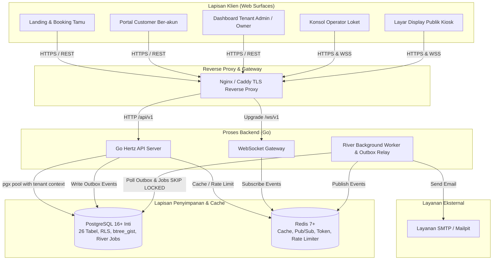
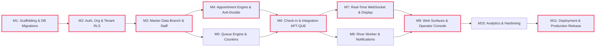

# Engineering Implementation Plan: Quevia (Smart Queue & Appointment Management)

**Versi Dokumen**: 1.0  
**Tanggal**: 10 November 2026  
**Status**: Approved & Actionable  
**Framework Perencanaan**: `planning-and-task-breakdown` (Addy Osmani), `implementation-planning` (Magnus919), `project-planning` (Britt)  
**Dokumen Acuan Resmi (Approved Baselines)**:
- `PRD — Quevia Smart Queue & Appointment Management.md` (v1.2 Approved)
- `System Architecture & API Contract — Quevia.md` (v1.1)
- `ERD — Quevia Database Design.md` (v1.1)

---

## 1. Executive Overview & Sasaran Proyek

Quevia adalah platform B2B SaaS multi-tenant yang mengintegrasikan sistem **Appointment Management** (penjadwalan mandiri anti-double booking) dan **Queue Management** (antrean terpadu harian di lokasi fisik, check-in QR/kode, pemanggilan loket operator, siaran real-time display kiosk, dan notifikasi otomatis).

### Sasaran Kunci (Delivery Goals)
1. **G-01**: Booking mandiri tanpa double-booking (PostgreSQL GiST exclusion constraint).
2. **G-02**: Antrean terpadu (walk-in FIFO + appointment berjadwal) dengan aturan prioritas dinamis.
3. **G-03**: Propagasi real-time display & status tiket < 1 detik (p95) via WebSocket & Redis Pub/Sub.
4. **G-04**: Pengiriman notifikasi andal (email konfirmasi + 3 pengingat berjenjang T-24h, T-60m, T-15m via River worker).
5. **G-05**: Dashboard analitik operasional untuk pemilik bisnis (utilisasi loket, waktu tunggu, rasio no-show).
6. **G-06**: Isolasi data multi-tenant mutlak (Middleware context + PostgreSQL Row-Level Security).
7. **G-07**: Portofolio berstandar enterprise (100% skenario kritis lolos uji konkurensi dan otomatisasi).
8. **Target Bisnis & Guardrail**: Penurunan tingkat no-show $\le 5\%$ dengan *counter-metric* kepuasan layanan $\ge 4.5/5.0$.

---

## 2. Arsitektur Sistem & Komponen Runtime

Diagram alur komponen runtime Quevia:



---

## 3. Peta Dependensi & Jalur Kritis (Critical Path)

Jalur kritis (*Critical Path*) adalah rantai pekerjaan terpanjang yang menentukan kecepatan rilis. Keterlambatan pada simpul jalur kritis akan menunda seluruh peluncuran:



**Critical Path Analysis**:
- `M1` (Migrasi DB) $\rightarrow$ `M2` (Auth & RLS) $\rightarrow$ `M3` (Master Data) $\rightarrow$ `M4` (Appointment Engine) $\rightarrow$ `M6` (Check-in Integration) $\rightarrow$ `M7` (WebSocket) $\rightarrow$ `M9` (Frontend Surfaces) $\rightarrow$ `M11` (Deployment).
- **Peluang Paralelisasi (Concurrent Tracks)**:
  - `M5` (Queue Engine Walk-in) dapat dikerjakan paralel dengan `M4` (Appointment Engine) setelah `M3` selesai.
  - `M8` (Worker Notifikasi) dapat dikerjakan paralel dengan `M7` (WebSocket Gateway).
  - Pengerjaan UI Frontend (`quevia-frontend`) dapat dimulai paralel begitu kontrak API (`openapi.yaml`) dan DTO types selesai pada tiap milestone backend.

---

## 4. Jadwal Pelaksanaan & Gantt Chart (8 Minggu / 4 Sprint)

```mermaid
gantt
    dateFormat  YYYY-MM-DD
    title Jadwal Pelaksanaan Rekayasa Quevia (8 Minggu)

    section Sprint 1: Foundation
    Setup Monorepo, Docker & Tooling       :done, s1_1, 2026-11-10, 3d
    PostgreSQL 26 Tabel & RLS Migration    :done, s1_2, after s1_1, 4d
    Auth Module, JWT, Tenant Scoping       :active, s1_3, after s1_2, 5d
    Checkpoint 1: Tenant Isolation Verified:crit, cp1, after s1_3, 2d

    section Sprint 2: Core Engines
    Master Data (Branch, Service, Staff)   :s2_1, after cp1, 4d
    Appointment Engine & GiST Exclusion    :s2_2, after s2_1, 5d
    Queue Engine (Counters & Walk-in)      :s2_3, after s2_1, 4d
    Check-in & Appointment-Queue Sync      :s2_4, after s2_2, 3d
    Checkpoint 2: Concurrency Tests Pass   :crit, cp2, after s2_4, 2d

    section Sprint 3: Realtime & Async
    Operator Console Business Logic        :s3_1, after cp2, 4d
    WebSocket Gateway & Redis Pub/Sub      :s3_2, after s3_1, 4d
    River Worker, Scheduled Reminders & Outbox:s3_3, after s3_1, 4d
    Kiosk Display Screen Logic             :s3_4, after s3_2, 3d
    Checkpoint 3: Live Real-Time & Email   :crit, cp3, after s3_4, 2d

    section Sprint 4: Frontend & Release
    Public Booking & Customer Tracking UI  :s4_1, after cp3, 4d
    Operator Console & Dashboard UI        :s4_2, after cp3, 4d
    Analytics Overview & Peak Hours        :s4_3, after s4_2, 3d
    WCAG 2.2 AA Accessibility & E2E Tests  :s4_4, after s4_1, 3d
    CI/CD GitHub Actions & Production Deploy:crit, s4_5, after s4_4, 3d
```

---

## 5. Work Breakdown Structure (WBS) & Task Checklist

Setiap task di bawah ini mematuhi standar ukuran terarah (*Sizing: XS, S, M, L; tanpa XL*) dengan kriteria pengujian mandiri (*Acceptance Criteria*) dan perintah verifikasi teknis.

---

### Phase 1: Foundation & Identity (Sprint 1: Minggu 1–2)

#### Task 1.1: Project Scaffolding & Tooling Setup
- **Deskripsi**: Inisialisasi struktur modular monolith backend Go Hertz, frontend Next.js App Router, Docker Compose, dan konfigurasi linter.
- **Ukuran**: Medium (M)
- **File Terdampak**:
  - `docker-compose.yml`, `Makefile`, `.env.example`
  - `backend/cmd/api/main.go`, `backend/cmd/worker/main.go`, `backend/go.mod`
  - `frontend/package.json`, `frontend/tsconfig.json`
- **Acceptance Criteria**:
  - [x] `docker compose up -d` (atau podman-compose) berhasil mengonfigurasi PostgreSQL 16, Redis 7, dan Mailpit.
  - [x] Server backend Go Hertz merespons `GET /healthz` dengan status 200 OK.
  - [x] Next.js app berjalan di port 3000 dengan Tailwind CSS dan TypeScript terkonfigurasi.
- **Verifikasi**:
  - `curl -f http://localhost:8080/healthz`
  - `docker compose ps` (semua container status healthy)
- **Dependensi**: Tidak ada.

#### Task 1.2: Database Migrations (26 Tabel, Indeks & RLS)
- **Deskripsi**: Menulis migration SQL lengkap untuk 26 tabel Quevia (ERD v1.1), mengaktifkan ekstensi `btree_gist`, constraint status, foreign key `ON DELETE RESTRICT`, partial unique indexes, dan row-level security policy.
- **Ukuran**: Large (L)
- **File Terdampak**:
  - `quevia-backend/migrations/000001_init_schema.up.sql`
  - `quevia-backend/migrations/000001_init_schema.down.sql`
  - `quevia-backend/sqlc.yaml`, `quevia-backend/sql/`
- **Acceptance Criteria**:
  - [ ] Seluruh 26 tabel terbuat tanpa error dependensi foreign key.
  - [ ] Tabel `appointments` memiliki constraint `ex_appointments_no_overlap` berbasis `btree_gist`.
  - [ ] Seluruh tabel ber-`tenant_id` memiliki policy `tenant_isolation` dan `FORCE ROW LEVEL SECURITY`.
  - [ ] Reserved user `guest` (`is_system = true`) terbuat pada script seed.
- **Verifikasi**:
  - `migrate -path quevia-backend/migrations -database "$DATABASE_URL" up`
  - `sqlc generate` berjalan tanpa warning/error.
- **Dependensi**: Task 1.1.

#### Task 1.3: Auth & Tenant Middleware dengan RLS Hook
- **Deskripsi**: Mengimplementasikan registrasi tenant (`POST /api/v1/tenants`), login, penerbitan access token JWT, refresh token di Redis (`rt:<jti>`), serta middleware penentuan tenant yang mengeksekusi `set_config('app.current_tenant_id', ...)` pada database connection pool.
- **Ukuran**: Medium (M)
- **File Terdampak**:
  - `quevia-backend/internal/platform/database/tx.go`
  - `quevia-backend/internal/platform/middleware/auth.go`
  - `quevia-backend/internal/platform/middleware/tenant.go`
  - `quevia-backend/internal/auth/handler.go`, `service.go`, `repository.go`
- **Acceptance Criteria**:
  - [ ] Tenant baru dapat mendaftar beserta cabang pertama dalam satu transaksi atomik.
  - [ ] Login menghasilkan Access Token di memori dan Refresh Token di httpOnly cookie.
  - [ ] Request dengan token Tenant A dilarang membaca baris data milik Tenant B di level database (RLS).
- **Verifikasi**:
  - `go test -v ./quevia-backend/internal/auth/...`
  - Integration test isolasi multi-tenant: insert data di Tenant A, query via context Tenant B menghasilkan 0 baris.
- **Dependensi**: Task 1.2.

---

#### 🏁 Checkpoint 1 (Akhir Sprint 1)
- [ ] Database migration up dan down berjalan 100% mulus.
- [ ] Multi-tenant isolation test lolos (0 kebocoran data antar-tenant).
- [ ] Autentikasi dan rotasi refresh token di Redis berfungsi normal.

---

### Phase 2: Master Data & Core Engines (Sprint 2: Minggu 3–4)

#### Task 2.1: Master Data (Cabang, Layanan, Staff, & Loket)
- **Deskripsi**: CRUD untuk branches, branch_settings (termasuk `notify_before_queue_count`), services, staff_profiles, staff_schedules, schedule_exceptions, dan service_counters.
- **Ukuran**: Medium (M)
- **File Terdampak**:
  - `quevia-backend/internal/branch/...`
  - `quevia-backend/internal/service/...`
  - `quevia-backend/internal/staff/...`
- **Acceptance Criteria**:
  - [ ] Admin dapat mengatur jam operasional mingguan cabang dan jam kerja staff.
  - [ ] Staff dapat diasosiasikan dengan layanan yang didukung via `staff_services`.
  - [ ] Penonaktifan staff dilarang jika masih memiliki appointment aktif `CONFIRMED` di masa depan (**FR-SVC-06, BR-19**).
- **Verifikasi**:
  - Unit test validasi penonaktifan staff dengan appointment aktif menolak dengan kode 422.
  - `go test -v ./quevia-backend/internal/staff/...`
- **Dependensi**: Task 1.3.

#### Task 2.2: Appointment Engine & Anti-Double Booking (GiST)
- **Deskripsi**: Perhitungan ketersediaan slot (`GET /api/v1/appointments/availability`), pembuatan booking mandiri tamu dengan `Idempotency-Key` (`POST /api/v1/appointments`), pembuatan `booking_code` berformat `QV-XXXXXX` dan `qr_token`, reschedule, serta cancel.
- **Ukuran**: Large (L)
- **File Terdampak**:
  - `quevia-backend/internal/appointment/availability.go`
  - `quevia-backend/internal/appointment/booking.go`
  - `quevia-backend/internal/platform/idempotency/idempotency.go`
- **Acceptance Criteria**:
  - [ ] Slot ketersediaan hanya menampilkan waktu yang bebas bentrok dengan jam kerja, cuti, istirahat, buffer, dan booking staff lain.
  - [ ] Booking tamu mewajibkan email valid dan mencatat audit log dengan reserved user `guest`.
  - [ ] Dua request booking bersamaan pada slot dan staff yang sama menghasilkan tepat 1 sukses dan 1 respon `409 SLOT_UNAVAILABLE` via GiST constraint.
  - [ ] Pengiriman ulang request dengan `Idempotency-Key` yang sama mengembalikan respons tersimpan tanpa membuat booking ganda.
- **Verifikasi**:
  - **Concurrency Test**: 50 goroutine melakukan booking konkuren pada slot yang sama $\rightarrow$ tepat 1 record tercipta di DB.
  - `go test -v -race ./quevia-backend/internal/appointment/...`
- **Dependensi**: Task 2.1.

#### Task 2.3: Queue Engine (Counters, Walk-in, & Check-in)
- **Deskripsi**: Pembuatan nomor antrean harian berbasis transaksi row-locking counter (`queue_counters`), pendaftaran walk-in anonim, check-in mandiri appointment (Web/QR/Kode) dalam check-in window, dan dukungan *manual check-in override* untuk pelanggan terlambat.
- **Ukuran**: Large (L)
- **File Terdampak**:
  - `quevia-backend/internal/queue/counter.go`
  - `quevia-backend/internal/queue/ticket.go`
  - `quevia-backend/internal/queue/checkin.go`
- **Acceptance Criteria**:
  - [ ] Generator antrean menggunakan `INSERT ... ON CONFLICT DO UPDATE RETURNING last_number` di dalam transaksi.
  - [ ] Tidak ada nomor antrean duplikat pada 100 request walk-in bersamaan.
  - [ ] Check-in appointment menghasilkan tepat satu `queue_tickets` berstatus `WAITING` dan mengubah appointment menjadi `CHECKED_IN`.
  - [ ] Operator dapat mengeksekusi `POST /api/v1/check-in/override` untuk menerbitkan tiket walk-in bagi appointment yang terlambat (**BR-20**).
- **Verifikasi**:
  - **Concurrency Test**: 100 goroutine request walk-in bersamaan $\rightarrow$ nomor antrean 1 s.d. 100 terurut sempurna tanpa celah (*gap* tak wajar) atau duplikasi.
  - `go test -v -race ./quevia-backend/internal/queue/...`
- **Dependensi**: Task 2.1, Task 2.2.

---

#### 🏁 Checkpoint 2 (Akhir Sprint 2)
- [ ] Concurrency Test Anti-Double Booking: 100% Lolos (0 double-booking).
- [ ] Concurrency Test Generator Nomor Antrean: 100% Lolos (0 nomor ganda).
- [ ] Integrasi Appointment dan Queue Ticket tersambung mulus.

---

### Phase 3: Real-Time, Queue Flow, & Workers (Sprint 3: Minggu 5–6)

#### Task 3.1: Operator Console Actions & State Synchronization
- **Deskripsi**: Logika pemanggilan antrean oleh operator: `call-next` menggunakan `SELECT ... FOR UPDATE SKIP LOCKED` berdasar prioritas, `recall`, `skip`, `start`, `complete`, `no-show`, serta sinkronisasi status appointment saat tiket dibatalkan/no-show (**BR-04, CR-03**).
- **Ukuran**: Medium (M)
- **File Terdampak**:
  - `quevia-backend/internal/queue/operator.go`
  - `quevia-backend/internal/queue/state_machine.go`
- **Acceptance Criteria**:
  - [ ] Dua operator yang menekan *Call Next* bersamaan tidak memanggil tiket yang sama.
  - [ ] Tiket `SKIPPED` dapat dipanggil kembali (`CALLED`) via recall (**CR-02**).
  - [ ] Tiket yang dibatalkan (`CANCELLED`) atau `NO_SHOW` otomatis meng-update status appointment terkait menjadi `CANCELLED` atau `NO_SHOW` dalam satu transaksi (**CR-03**).
  - [ ] Menyelesaikan tiket (`complete`) otomatis memperbarui appointment terkait menjadi `COMPLETED`.
- **Verifikasi**:
  - `go test -v ./quevia-backend/internal/queue/...`
- **Dependensi**: Task 2.3.

#### Task 3.2: WebSocket Gateway & Redis Pub/Sub
- **Deskripsi**: Mengimplementasikan endpoint WebSocket `/ws/v1/branches/:branchGuid/queue` (`coder/websocket`), autentikasi pesan pertama, multiplexing channel Redis, penyebaran event katalog antrean, dan heartbeat ping/pong.
- **Ukuran**: Medium (M)
- **File Terdampak**:
  - `quevia-backend/internal/realtime/gateway.go`
  - `quevia-backend/internal/realtime/hub.go`
  - `quevia-backend/internal/platform/cache/redis.go`
- **Acceptance Criteria**:
  - [ ] Klien yang tidak mengirim pesan `auth` valid dalam 5 detik otomatis diputus koneksinya.
  - [ ] Display screen dan operator menerima event `queue.ticket_called` dengan latensi p95 < 1.000 ms.
  - [ ] Event bersifat idempotence-safe (menyertakan `event_id`).
- **Verifikasi**:
  - Test skenario koneksi 50 klien WebSocket secara lokal, trigger event `call-next`, verifikasi seluruh 50 klien menerima pesan dalam < 500 ms.
- **Dependensi**: Task 3.1.

#### Task 3.3: Background Worker (River), Outbox Relay, & Email Scheduler
- **Deskripsi**: Mengonfigurasi proses worker River (`cmd/worker/main.go`), outbox relay dispatcher ke Redis, pengiriman email SMTP dengan exponential backoff retry, pengevaluasian kedekatan antrean (`QUEUE_ALMOST_CALLED`), dan scheduler pengingat berjenjang (T-24h, T-60m, T-15m).
- **Ukuran**: Large (L)
- **File Terdampak**:
  - `quevia-backend/cmd/worker/main.go`
  - `quevia-backend/internal/notification/worker.go`
  - `quevia-backend/internal/notification/mailer.go`
  - `quevia-backend/internal/platform/outbox/relay.go`
- **Acceptance Criteria**:
  - [ ] Event outbox berstatus `PENDING` diproses dan dialihkan ke Redis Pub/Sub tanpa data tercecer.
  - [ ] Email konfirmasi dan pengingat berjadwal terkirim ke Mailpit secara tepat waktu.
  - [ ] Jika SMTP down, worker me-retry hingga 5 kali dengan backoff sebelum menandai `FAILED`.
  - [ ] Notifikasi `QUEUE_ALMOST_CALLED` dipicu saat sisa antrean mencapai ambang `notify_before_queue_count`.
- **Verifikasi**:
  - `go test -v ./quevia-backend/internal/notification/...`
  - Buka UI Mailpit (`http://localhost:8025`) dan verifikasi isi email konfirmasi serta format token QR.
- **Dependensi**: Task 3.2.

---

#### 🏁 Checkpoint 3 (Akhir Sprint 3)
- [ ] Operator console dapat mengendalikan siklus tiket secara penuh.
- [ ] Layar display publik kiosk menerima pembaruan real-time via WebSocket.
- [ ] Notifikasi email dan background worker berjalan stabil di background.

---

### Phase 4: Frontend Web Surfaces, Hardening & Release (Sprint 4: Minggu 7–8)

#### Task 4.1: Public Customer Surfaces (Booking, Check-in, & Tracking)
- **Deskripsi**: Membangun halaman antarmuka publik customer berbasis Next.js App Router: katalog cabang/layanan, pemilih slot interaktif, konfirmasi booking, halaman check-in QR, dan halaman pelacak antrean dinamis.
- **Ukuran**: Large (L)
- **File Terdampak**:
  - `quevia-frontend/app/(public)/booking/page.tsx`
  - `quevia-frontend/app/(public)/check-in/page.tsx`
  - `quevia-frontend/app/(public)/track/[ticketGuid]/page.tsx`
  - `quevia-frontend/hooks/useQueueSocket.ts`
- **Acceptance Criteria**:
  - [ ] Alur booking tamu berjalan mulus dari pemilihan tanggal hingga halaman sukses `QV-XXXXXX`.
  - [ ] Halaman check-in mendukung pembacaan query token dari kamera / scan QR.
  - [ ] Halaman pelacakan tiket menampilkan sisa antrean dan otomatis update status saat dipanggil tanpa refresh.
  - [ ] Memenuhi standar aksesibilitas WCAG 2.2 Level AA (kontras warna $\ge 4.5:1$, keyboard nav).
- **Verifikasi**:
  - Lighthouse Accessibility Score $\ge 95$.
  - Uji alur booking di browser desktop dan mobile viewport.
- **Dependensi**: Task 2.2, Task 3.2.

#### Task 4.2: Operator Counter Console & Kiosk Public Display
- **Deskripsi**: Membangun antarmuka loket operator (`(operator)/counter`) dengan aksi Call Next, Recall, Skip, Complete, serta tampilan layar publik kiosk (`display/[branchGuid]`) dengan tipografi besar dan audio bell.
- **Ukuran**: Medium (M)
- **File Terdampak**:
  - `quevia-frontend/app/(operator)/counter/page.tsx`
  - `quevia-frontend/app/display/[branchGuid]/page.tsx`
  - `quevia-frontend/components/queue/AudioAnnouncer.tsx`
- **Acceptance Criteria**:
  - [ ] Layar display menampilkan loket aktif, nomor yang sedang dipanggil, dan 3 nomor antrean berikutnya.
  - [ ] Tombol inisialisasi suara ("Aktifkan Suara") menangani pembatasan autoplay browser.
  - [ ] Banner visual "Menghubungkan kembali..." tampil jika koneksi terputus dan otomatis sinkronisasi ulang saat online.
- **Verifikasi**:
  - Buka konsol operator di Tab 1, buka layar display di Tab 2. Tekan Call Next $\rightarrow$ Tab 2 berbunyi dan nomor berganti seketika.
- **Dependensi**: Task 3.1, Task 3.2.

#### Task 4.3: Business Owner Dashboard & Analytics
- **Deskripsi**: Membangun dashboard analitik untuk Business Owner: metrik volume harian, waktu tunggu rata-rata, durasi pengerjaan, jam sibuk (*peak hours*), dan rasio no-show.
- **Ukuran**: Medium (M)
- **File Terdampak**:
  - `quevia-frontend/app/(dashboard)/analytics/page.tsx`
  - `quevia-backend/internal/analytics/service.go`, `handler.go`
- **Acceptance Criteria**:
  - [ ] Grafik dan kartu metrik menyajikan data akurat berdasarkan filter rentang tanggal dan cabang.
  - [ ] Target KPI no-show ($\le 5\%$) dan CSAT ($\ge 4.5$) terpantau secara visual.
- **Verifikasi**:
  - `curl -H "Authorization: Bearer $ADMIN_TOKEN" http://localhost:8080/api/v1/analytics/overview`
- **Dependensi**: Task 3.1.

#### Task 4.4: Hardening, E2E Testing, & Production Deployment
- **Deskripsi**: Menulis End-to-End Test (Playwright), mengonfigurasi GitHub Actions CI/CD pipeline, setup konfigurasi reverse proxy TLS di VPS, dan deployment produksi.
- **Ukuran**: Large (L)
- **File Terdampak**:
  - `.github/workflows/ci.yml`, `.github/workflows/deploy.yml`
  - `e2e/booking_and_queue.spec.ts`
  - `deploy/docker-compose.prod.yml`, `deploy/Caddyfile`
- **Acceptance Criteria**:
  - [ ] E2E Playwright test menguji alur lengkap: Booking $\rightarrow$ Check-in $\rightarrow$ Call Next $\rightarrow$ Complete.
  - [ ] Pipeline CI menjalankan linting Go, typecheck Next.js, dan automated test secara otomatis di setiap push.
  - [ ] Deployment VPS berjalan dengan Zero-Downtime Migration dan HTTPS otomatis.
- **Verifikasi**:
  - `npx playwright test` $\rightarrow$ Seluruh skenario E2E hijau (passed).
  - Akses domain produksi publik dengan HTTPS valid.
- **Dependensi**: Task 4.1, Task 4.2, Task 4.3.

---

#### 🏁 Checkpoint 4 (Akhir Sprint 4 — Final Release Gate)
- [ ] 100% User Stories (US-01 s.d. US-10) terverifikasi berjalan di lingkungan produksi.
- [ ] Seluruh target NFR (WCAG 2.2 AA, p95 latensi, SLO 99.5%) terpenuhi.
- [ ] Sistem Quevia resmi rilis dan siap dipresentasikan sebagai portofolio level enterprise.

---

## 6. Strategi Rollout, Rollback, & Pemulihan (Disaster Recovery)

### 6.1 Strategi Peluncuran Bertahap (Staged Rollout)
1. **Tahap 1: Alpha Testing (Lokal / Staging)**
   - Pengujian terisolasi menggunakan data tiruan (*seed data*). Validasi beban konkurensi (50 booking konkuren & 100 walk-in konkuren).
2. **Tahap 2: Beta Pilot (Single Branch)**
   - Uji coba lapangan pada 1 cabang percontohan selama 1 minggu. Mengumpulkan umpan balik operator dan mengukur tingkat stabilitas WebSocket.
3. **Tahap 3: General Availability (Multi-Tenant Multi-Branch)**
   - Pembukaan pendaftaran tenant publik secara penuh.

### 6.2 Prosedur Rollback & Pemulihan Database
- **Skema Migrasi**: Seluruh migrasi database bersifat *forward-only* dan dilengkapi skrip pembalik (`.down.sql`).
- **Data Backup**: Pencadangan otomatis harian database PostgreSQL (pg_dump) dan replikasi WAL (*Write-Ahead Logging*) dengan RPO $\le 1$ jam.
- **Penyelamatan Sesi**: Jika Redis mengalami kegagalan/restart, access token JWT di memori tetap valid hingga masa kedaluwarsa 15 menit habis, dan pengguna cukup login ulang untuk memperbarui refresh token tanpa kehilangan data transaksi bisnis di database.

---

## 7. Definition of Done (DoD) Proyek

Setiap task dan milestone baru dapat dinyatakan **DONE** jika memenuhi kriteria mutlak:
1. **Code Quality**: Lolos linting Go (`golangci-lint`) dan Next.js ESLint/Prettier tanpa *warning*.
2. **Testing**: Unit test dan integration test mencakup $\ge 80\%$ kode baru; skenario konkurensi lolos 100%.
3. **Security**: Tidak ada celah OWASP Top 10; query RLS terverifikasi aman dari kebocoran lintas tenant.
4. **Contract Fidelity**: Endpoint HTTP dan pesan WebSocket patuh 100% terhadap `openapi.yaml` dan dokumen Arsitektur.
5. **Documentation**: Perubahan endpoint atau konfigurasi tercatat di README dan dokumen terkait.
